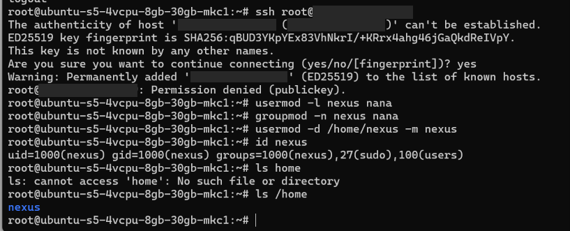
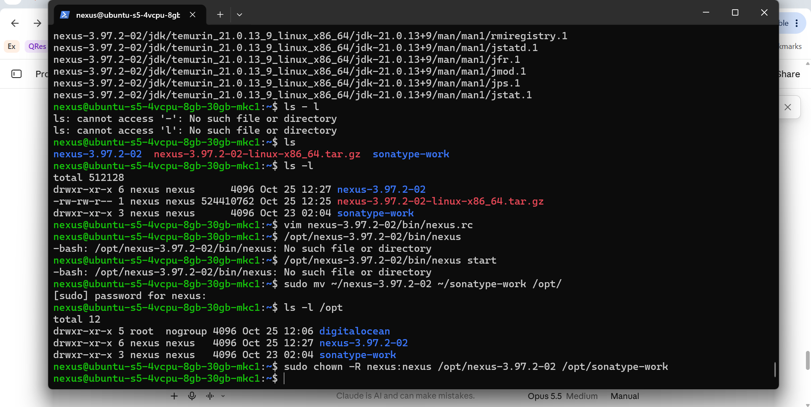
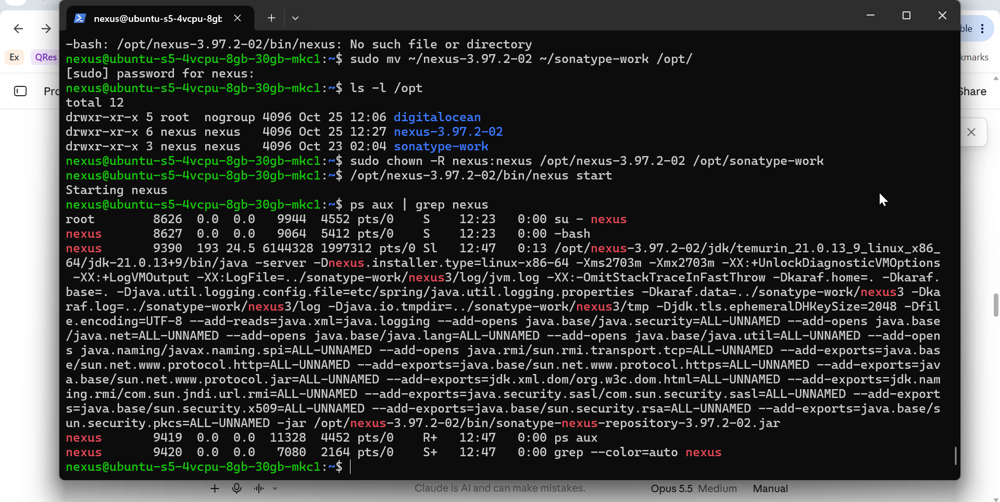
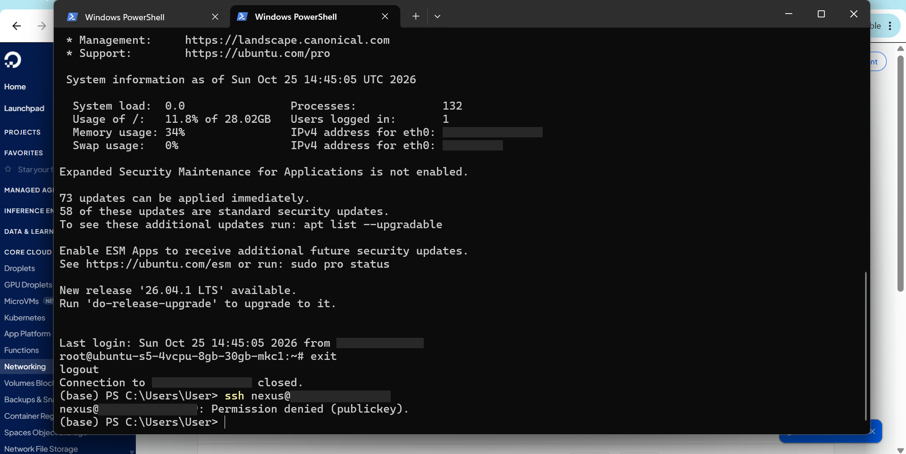
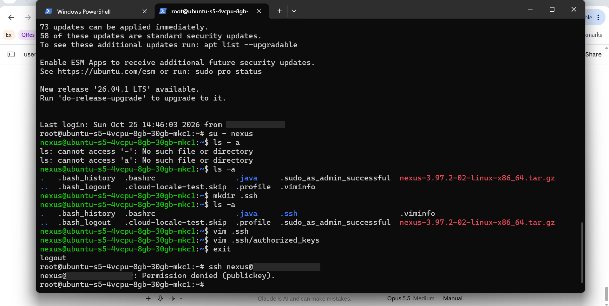
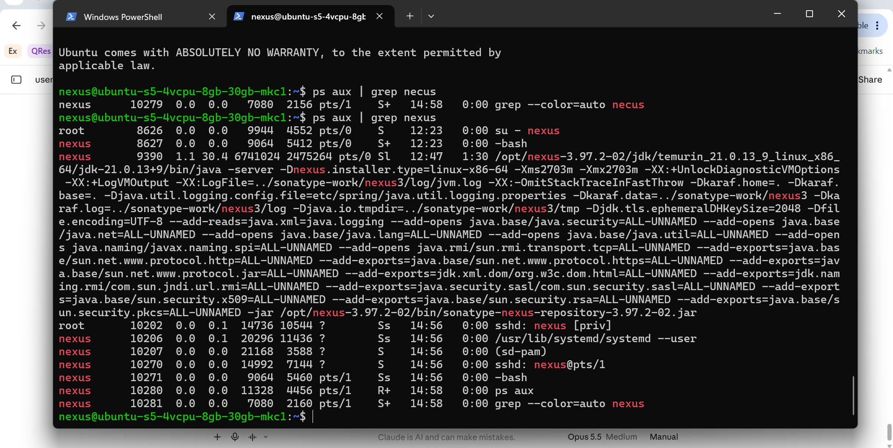
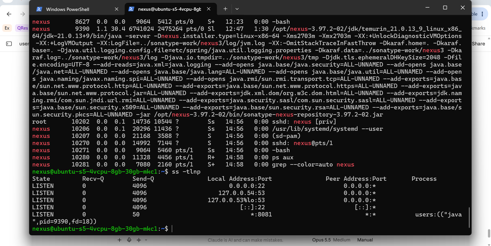
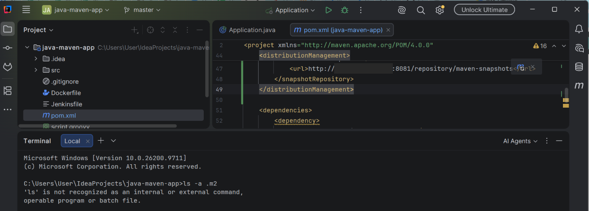
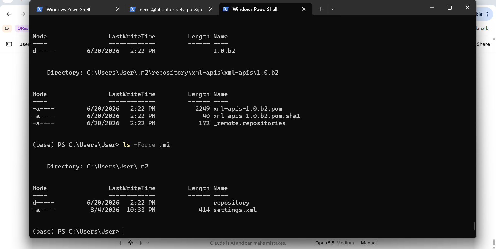
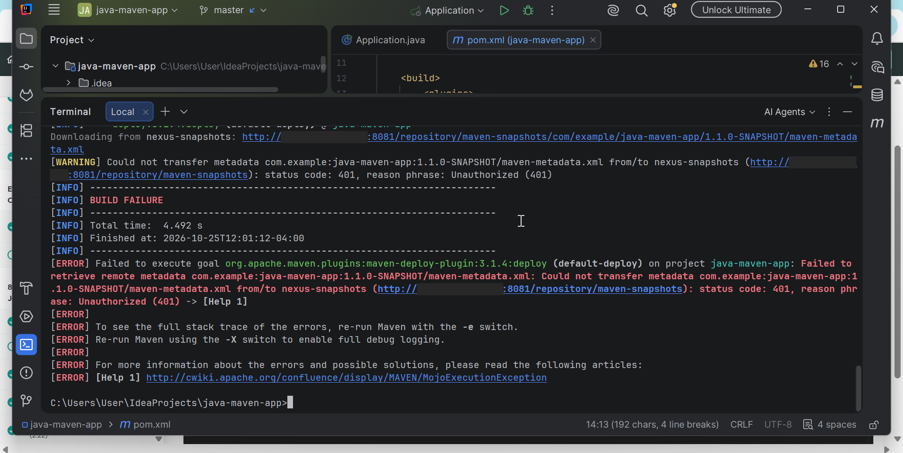

# Nexus Artifact Repository on DigitalOcean + Maven Deploy

## Project

Install and configure Nexus on a cloud server, then publish a Java Maven artifact to it.

**Technologies:** DigitalOcean, Linux (Ubuntu), Nexus Repository Manager 3, Java, Maven

**What I did:**

- Created a Droplet on DigitalOcean and a dedicated Linux service user (`nexus`) to run Nexus
- Installed Nexus, moved it to `/opt` (best practice for app files), and started it as the `nexus` user
- Set up SSH key login for the `nexus` user
- Configured a local Maven project to deploy to Nexus (`maven-deploy-plugin`, `distributionManagement`, `~/.m2/settings.xml`)
- Uploaded the jar to the `maven-snapshots` repository with `mvn deploy`

> IP addresses are redacted in commands, logs and screenshots. `<droplet-ip>` = the server's public IP.
> Credentials are never stored in this repo. `config/settings.xml.example` uses placeholders.

---

## Steps

### 1. SSH into the remote server

```bash
ssh root@<droplet-ip>
```

### 2. Create a user

```bash
adduser nana
apt update
```

### 3. Corrected the service account name to `nexus`

A service should run under a user named after it. So I renamed `nana` to `nexus`.

A Linux "user" is really three separate things: the login name, a group with the same name, and a home folder. Renaming one does not rename the others.

As root:

```bash
usermod -l nexus nana              # rename the user (new name first, old name last)
groupmod -n nexus nana             # rename the matching group
usermod -d /home/nexus -m nexus    # point to the new home folder, and -m moves the files there
id nexus
ls /home
```

- `-l` = new login name
- `-n` = new group name
- `-d` = new home folder (only updates the record)
- `-m` = actually move the old home folder's contents. Without it, the files stay in `/home/nana`
- Line 3 says `nexus`, not `nana`, because line 1 already renamed the user

`id nexus` shows the same UID (1000) as before. Linux tracks ownership by number, not name, so every file still belongs to this user.



### 4. Install Java

```bash
su - nexus
sudo apt install openjdk-25-jre-headless
```

> Note: this Nexus version ships with its own Java. `ps aux` (step 8) shows it running from `/opt/nexus-3.97.2-02/jdk/temurin_21...`, not the system Java.

### 5. Download and unpack Nexus

As `nexus`, in its home folder:

```bash
wget https://download.sonatype.com/nexus/3/nexus-3.97.2-02-linux-x86_64.tar.gz
tar -zxvf nexus-3.97.2-02-linux-x86_64.tar.gz
```

This creates two folders:

- `nexus-3.97.2-02` = the Nexus app
- `sonatype-work` = Nexus data (config, logs, uploaded artifacts)

### 6. Tell Nexus which user to run as

```bash
vim nexus-3.97.2-02/bin/nexus.rc
```

Content (see [`config/nexus.rc`](config/nexus.rc)):

```
run_as_user="nexus"
```

### 7. Fixed the install location: moved Nexus to `/opt`

`/opt/nexus-3.97.2-02/bin/nexus start` failed with `No such file or directory`.

**Why:** the files were still in `/home/nexus`, not `/opt`.

`/opt` is the standard place for add-on apps, so I moved both folders there:

```bash
sudo mv ~/nexus-3.97.2-02 ~/sonatype-work /opt/
sudo chown -R nexus:nexus /opt/nexus-3.97.2-02 /opt/sonatype-work
ls -l /opt
```

- `-R` = recursive: change the folder and everything inside it
- `ls -l` already showed `nexus nexus` before the `chown`, because `mv` keeps ownership. So `chown` was a safety step here



### 8. Start Nexus and check the process

```bash
/opt/nexus-3.97.2-02/bin/nexus start
ps aux | grep nexus
```

Which row is Nexus? Nexus is a Java program, so it shows up as the long `java ... sonatype-nexus-repository-3.97.2-02.jar` row. The other rows are my `su` session, my shell, and `ps`/`grep` catching themselves.



### 9. SSH didn't work for `nexus`, so I added my SSH key

`ssh nexus@<droplet-ip>` failed with `Permission denied (publickey)`.

**Why:** SSH looks for keys in the home folder of the user you log in as. My laptop's public key was only in `/root/.ssh/authorized_keys`. `/home/nexus/.ssh` didn't exist.



As `nexus`:

```bash
mkdir .ssh
vim .ssh/authorized_keys
# i, <paste my public key (the .pub file from my laptop), one single line>, Esc, :wq
```

Recommended permissions (SSH ignores keys if these are too open):

```bash
chmod 700 ~/.ssh
chmod 600 ~/.ssh/authorized_keys
```

**My mistake while testing:** after `exit`, I was still on the server as root (only the `su` session closed). So `ssh` ran from the server, with the server's keys, not my laptop's. It failed again.



Testing from my laptop (PowerShell) worked. `sshd: nexus@pts/1` confirms the SSH login as `nexus`:



### 10. Find which port Nexus listens on

`ps` shows programs, not ports. `ss` shows ports.

```bash
ss -tlnp
```

- `-t` TCP, `-l` listening only, `-n` numbers not names, `-p` owning program

`*:8081` owned by `java` (pid 9390) = Nexus, open on all interfaces. Nexus UI: `http://<droplet-ip>:8081`



---

## Deploy a Maven artifact to Nexus

### 11. Add the deploy plugin to `pom.xml`

Under `<build>` → `<plugins>`:

```xml
<plugin>
    <groupId>org.apache.maven.plugins</groupId>
    <artifactId>maven-deploy-plugin</artifactId>
    <version>3.1.4</version>
</plugin>
```

The deploy plugin is the tool that uploads the built jar. The three lines are its address: who made it, what it's called, which version. Pinning the version means every machine uses the same one.

### 12. Tell Maven where to upload: `distributionManagement`

After `<build>`:

```xml
<distributionManagement>
    <snapshotRepository>
        <id>nexus-snapshots</id>
        <url>http://<droplet-ip>:8081/repository/maven-snapshots</url>
    </snapshotRepository>
</distributionManagement>
```

The version is `1.1.0-SNAPSHOT`, so Maven uses `snapshotRepository`.

Both snippets: [`config/pom-snippet.xml`](config/pom-snippet.xml)



### 13. Add Nexus credentials in `~/.m2/settings.xml`

On Windows: `C:\Users\User\.m2\settings.xml`.

`.m2` is a folder Maven creates in the home folder. It holds `settings.xml` (personal settings) and `repository` (the local download cache).

```xml
<settings xmlns="http://maven.apache.org/SETTINGS/1.0.0"
          xmlns:xsi="http://www.w3.org/2001/XMLSchema-instance"
          xsi:schemaLocation="http://maven.apache.org/SETTINGS/1.0.0 https://maven.apache.org/xsd/settings-1.0.0.xsd">
  <servers>
    <server>
      <id>nexus-snapshots</id>
      <username>NEXUS_USERNAME</username>
      <password>NEXUS_PASSWORD</password>
    </server>
  </servers>
</settings>
```

- The `<id>` must match the `<id>` in `distributionManagement` exactly. That's how Maven knows which login goes with which repo
- **Why not in `pom.xml`?** `pom.xml` goes into Git. Credentials stay on my machine, never in the project

Windows note: in PowerShell, `ls -a` is not Linux `ls -a`. Use `ls -Force .m2` to see hidden items. In `cmd`, use `dir /a`.



### 14. Build and deploy

In the project folder:

```bash
mvn package
mvn deploy
```

`mvn deploy` runs every earlier lifecycle step too (compile, test, package, install), then uploads.

### 15. First deploy failed with 401 Unauthorized

**Why:** the username in `settings.xml` was wrong.

**How I read the log:** find `BUILD FAILURE`, look at the step header above it (`--- deploy:3.1.4:deploy ---`), then read the first `[ERROR]` line: `status code: 401, Unauthorized`. Everything before `deploy` passed, so the build was fine. Only the login failed.

Full log: [`logs/mvn-deploy-401.log`](logs/mvn-deploy-401.log)



Quick reference for Nexus errors:

| Error | Meaning |
|---|---|
| `401` | wrong or missing login |
| `403` | logged in, but no permission to upload |
| `404` | wrong URL or repo name |
| `400` | often: re-uploading a release version that already exists |
| `Connection timed out` | network or firewall |
| `Connection refused` | server reachable, nothing listening on that port |

### 16. Fixed the username, deployed again: BUILD SUCCESS

```
Uploaded to nexus-snapshots: .../java-maven-app-1.1.0-20261025.160334-1.pom (2.7 kB)
Uploaded to nexus-snapshots: .../java-maven-app-1.1.0-20261025.160334-1.jar (24 MB)
...
BUILD SUCCESS
```

Nexus stores `1.1.0-SNAPSHOT` as `1.1.0-<date>.<time>-<build number>`, so each snapshot upload is kept, not overwritten.

Full log: [`logs/mvn-deploy-success.log`](logs/mvn-deploy-success.log)

### 17. Check the artifact in Nexus

Nexus UI → Browse → `maven-snapshots` → `com/example/java-maven-app/1.1.0-SNAPSHOT/`.

The path follows groupId → artifactId → version, the same pattern as the local `.m2/repository`.

---

## Repo contents

```
README.md
config/
  nexus.rc                 # run_as_user for Nexus
  pom-snippet.xml          # deploy plugin + distributionManagement
  settings.xml.example     # Maven credentials template (placeholders only)
logs/
  mvn-deploy-401.log
  mvn-deploy-success.log
proofs/                    # screenshots, IPs redacted
```
